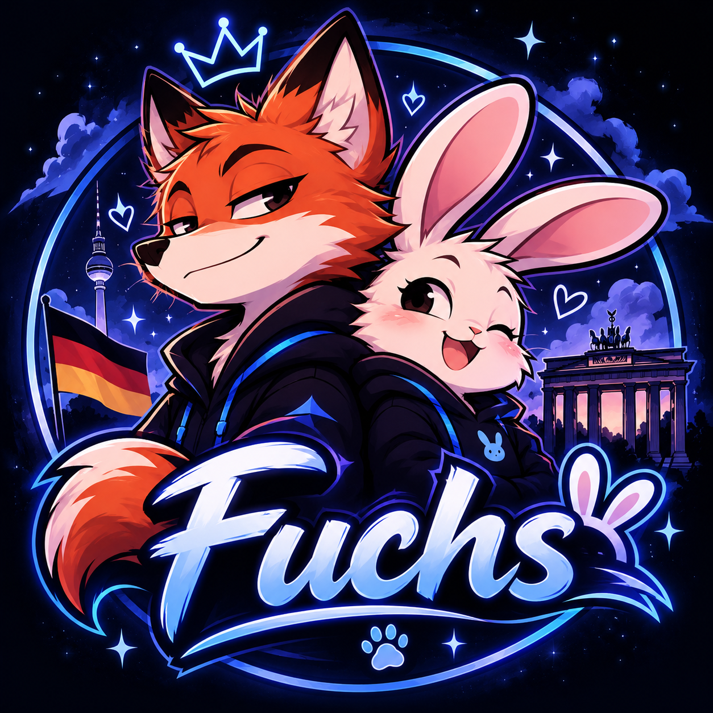

# 🦊 Fuchs - Retro 2D Endless Runner



**Fuchs** (Almanca: *Tilki*), Android için Kotlin ve Android Canvas API kullanılarak geliştirilmiş, nostaljik piksel sanatı (pixel art) ve akıcı mekaniklere sahip sonsuz koşu oyunudur.


---

## 🌟 Özellikler

- 🎭 **Karakter Seçim Sistemi:** Başlangıç ekranında iki farklı piksel karakter arasında seçim yapma imkanı:
  - 🦊 **Sevimli Tilki** (Pofuduk beyaz kuyruklu & pembe yanaklı)
  - 🐰 **Yakışıklı Tavşan** (Kırmızı fiyonk kravatlı & uzun kulaklı)
- 🪙 **Toplanabilir Altın / Para Sistemi:** Havada ve yerde beliren altınları toplayarak ekstra puan kazanın; toplam altın miktarınız otomatik olarak cihazda saklanır.
- 🌙 **Gece / Gündüz Döngüsü:** Skor ilerledikçe gündüzden gün batımına ve yanıp sönen yıldızlar ile pikselli ayın çıktığı büyüleyici gece gökyüzüne yumuşak renk geçişleri.
- 🔊 **Retro 8-Bit Ses Efektleri (Chiptune SFX):** Herhangi bir dış ses dosyasına gerek kalmadan varsayılan sentezleyici ile üretilen nostaljik zıplama, altın toplama ve oyun bitti bipleri.
- 🎨 **Retro Pixel Art Görünümü:** Özel sanal piksel ızgarası (Virtual Pixel Canvas) ile tamsayı ölçekleme kullanılarak keskin piksel grafikleri sunar.
- ⚡ **Yüksek Performanslı Oyun Döngüsü:** `SurfaceView` ve `Thread` tabanlı bağımsız oyun döngüsü (60 FPS hedefli).
- 🌵 **Çeşitli Engeller:** 
  - Farklı boyutta kaktüsler (küçük, büyük, ikili kaktüs kümesi).
  - Kanat çırpan kuşlar (Pterodactyl).
- 💥 **Görsel Efektler:**
  - Koşma ve zıplama için piksel toz parçacıkları, altın toplandığında ışıltı patlaması (Particle System).
  - Çarpışma anında ekran sarsıntısı (Screen Shake) ve patlama efekti.
  - Skor rekoru kırıldığında görsel kutlama.
- 📳 **Dokunsal Geri Bildirim (Haptic Feedback):** Zıplama ve çarpışma anlarında titreşim ile dokunsal his.
- 🏆 **Skor Sistemi & Yüksek Skor Saklama:** `SharedPreferences` ile en yüksek skor otomatik kaydedilir.
- 📱 **Tam Ekran Desteği:** Edge-to-edge immersiv tam ekran deneyimi.

---

## 🕹️ Nasıl Oynanır?

- **Karakter Seç:** Başlangıç ekranındaki panele dokunarak **Tilki 🦊** veya **Yakışıklı Tavşan 🐰** karakterini seçin (tercihiniz saklanır).
- **Başlat:** Ekrana dokunarak oyunu başlatın.
- **Zıpla:** Yerdeyken ekrana dokunarak zıplayın ve engellerin üzerinden atlayın.
- **Yeniden Başla:** Karakteriniz bir engelle çarptığında ekrana dokunarak yeniden başlayabilirsiniz.

---

## 🛠️ Teknik Mimari

Proje harici hiçbir ağır oyun motoru (LibGDX, Unity vb.) kullanılmadan **saf Kotlin ve varsayılan Android SDK** bileşenleriyle yazılmıştır.

- **`GameView.kt`**: `SurfaceView` ve `Runnable` implementasyonu ile oyun döngüsü (game loop), fizik motoru, parçacık sistemi, çarpışma algılama (AABB) ve özel piksel çizimlerini yönetir.
- **`MainActivity.kt`**: Oyun görünümünü başlatır, ekranın kapanmasını engeller ve tam ekran (immersive mode) düzenini sağlar.

---

## 🚀 Projeyi Derleme ve Çalıştırma

### Gereksinimler
- Android Studio Ladybug (veya daha yeni bir sürüm)
- JDK 17+
- Android API 24+ (Android 7.0+) cihaz veya emülatör

### Adımlar
1. Depoyu klonlayın:
   ```bash
   git clone https://github.com/kullaniciadi/PixelGame.git
   cd PixelGame
   ```
2. Android Studio'da projeyi açın ve Gradle Senkronizasyonunun (Gradle Sync) tamamlanmasını bekleyin.
3. Bir emülatör veya USB ile bağlı gerçek Android cihaz seçerek **Run** (`Shift + F10`) butonuna basın.

---

## 📄 Lisans

Bu proje [MIT Lisansı](LICENSE) altında lisanslanmıştır.
